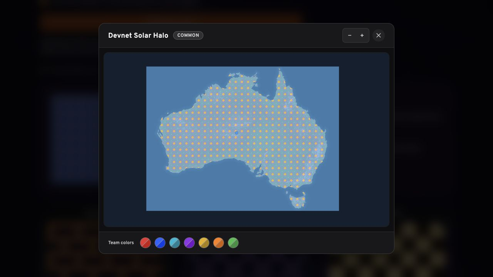
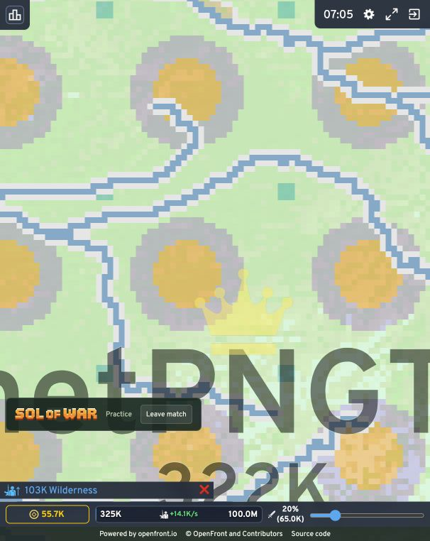

# Sol of War custom PNG purchase and match evidence

On October 30, 2026 Pacific (October 31 UTC), the actual local Sol of War shop
completed a custom territory-pattern purchase on **Solana devnet**. The player
uploaded a PNG, previewed its repeated appearance before purchase, approved a
**500,000 test $SOLOFWAR burn**, equipped the unlocked pattern, and used it in a
running **free local practice match**. The project owner also confirmed it worked
in game.

This is not a mainnet shop purchase or a public multiplayer load test. Production
checkout remains disabled. Ordinary catalog prices and production sponsorship
configuration still need approval before launch.

## Finalized purchase

[View the finalized custom-pattern burn](https://explorer.solana.com/tx/27ePsYvYfKaurGvg8z28MLBbywWYZdLcos5EE7rjaF2g7VTJwQLYZ66YdAma8FmtKdK8swBChRLaXUuUBhpA5FVk?cluster=devnet)

| Check                | Result                                                      |
| -------------------- | ----------------------------------------------------------- |
| Item                 | Devnet Solar Halo, custom territory pattern                 |
| Item ID              | `custom-94eb24af2959a7a3abacfdfd`                           |
| Price burned         | 500,000 test $SOLOFWAR                                      |
| Token program        | Token-2022, `BurnChecked`                                   |
| Finalized slot       | 517019321                                                   |
| Mint supply          | 1,000,000 to 500,000 test tokens                            |
| Player token balance | 1,000,000 to 500,000 test tokens                            |
| Player SOL balance   | 0.03897 SOL before and after                                |
| Platform fee         | 0.00001 SOL, paid by the temporary sponsor                  |
| Sponsor SOL balance  | 0.011 to 0.01099 SOL                                        |
| Entitlement          | One permanent ownership record, one equipped territory slot |
| Source tested        | `13276887168776d58e7f0eb838712e48f549fead`                  |

The separate six-decimal test mint is
`7jVWYJaDywUtgqtGCdyanrBVxnyDQdebXnxtdN26fHoC`.
Its [setup transaction](https://explorer.solana.com/tx/2kvTKJmqQGJCJxZRTJdqc2FcovwPpoxBZk2XvFg7JQkTxgZgorQNhKUEZNGNm3BozXiyt2WLmifopyvoAVmuHRXR?cluster=devnet)
created the test supply and revoked mint authority. It is not the production
$SOLOFWAR mint.

[Machine-readable evidence](evidence/custom-png-devnet-2026-10-30.json) contains
addresses, raw balances, the receipt, and verification results.

## Verified player route

1. An existing isolated development account signed in through Privy. A local
   test-account sign-in helper supplied its login signature; the normal backend
   verified the Privy identity and wallet ownership. No personal-wallet spending
   delegation was granted.
2. On the actual `/shop` page, the player uploaded the original
   [32 by 32 PNG test tile](evidence/custom-pattern-test-tile.png), acknowledged
   ownership of the artwork, and saved a free draft. Its gold and cyan pixels are
   opaque, violet pixels are half-transparent, and the background is transparent.
3. The shop showed both the repeating swatch and the game-renderer preview before
   purchase. No token burn was needed to preview.
4. The shop prepared the exact mint, amount, source, sponsor, and purchase memo.
   The browser validated those terms, and the test wallet signed through Privy's
   devnet confirmation. The platform verified the signature, co-signed the fee,
   persisted the payment, and reconciled it to finalization.
5. Finalized Solana transaction data confirmed `BurnChecked`, the exact raw amount
   `500000000000`, no transaction error, and the sponsor as fee payer. Finalized
   account reads independently confirmed the supply and balance changes above.
6. The shop displayed **Burn finalized · Owned**. Equipment was selected through
   the shop UI. A fresh database read confirmed the entitlement and equipped slot;
   the purchased public PNG matched the stored artwork.
7. The equipped pattern rendered across expanding territory in local practice
   match `ee5d5860`. Original color and alpha were retained by the repeating
   pattern; normal terrain and game-status rendering still applies.

### Before purchase

### In the running match

## Expiry handling and cleanup

The first quote expired while the wallet frame was loading. The server rejected
it before sponsorship or broadcast. The unsigned quote was cancelled, and a new
quote produced the single finalized burn above. No duplicate burn or fee occurred.

After verification, the temporary sponsor policy was set to deny signing. A fresh
provider signing request was rejected. The earlier shop-test sponsor stayed
retired throughout. Production settings and personal-wallet authority were not
changed; the remaining valueless devnet SOL stays in the retired test sponsor.

## Token utility

The implemented utility is **cosmetic purchases and custom artwork unlocks**.
The full $SOLOFWAR purchase price is destroyed by a token burn instruction; it is
not transferred to the operator or a burn-address wallet. Sol of War pays the
purchase transaction's network fee, and ownership unlocks only after finalization.
Cosmetics confer no combat, matchmaking, win-condition, or payout advantage.
SOL match entries and custodial prize pools remain separate.

See [shop mechanics](COSMETIC_SHOP.md) and [catalog prices](COSMETIC_CATALOG.md).
