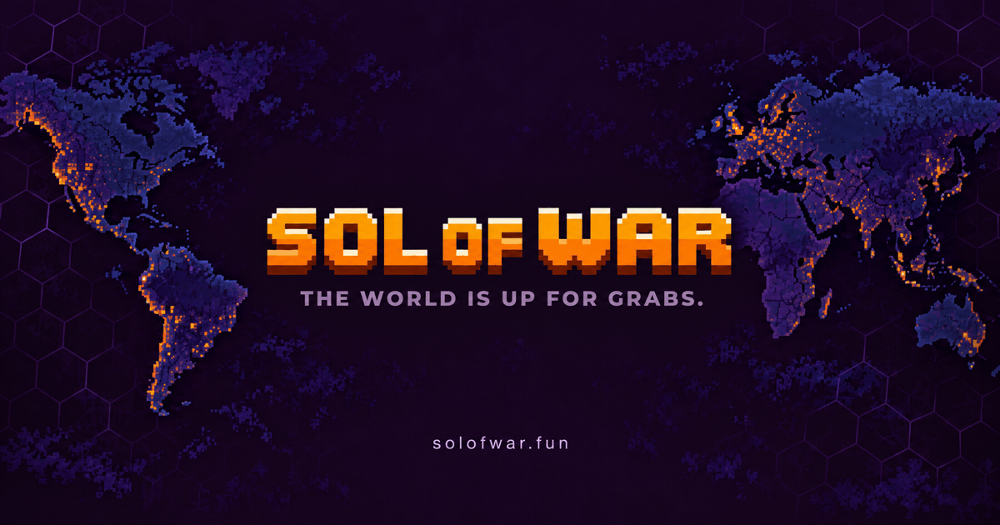
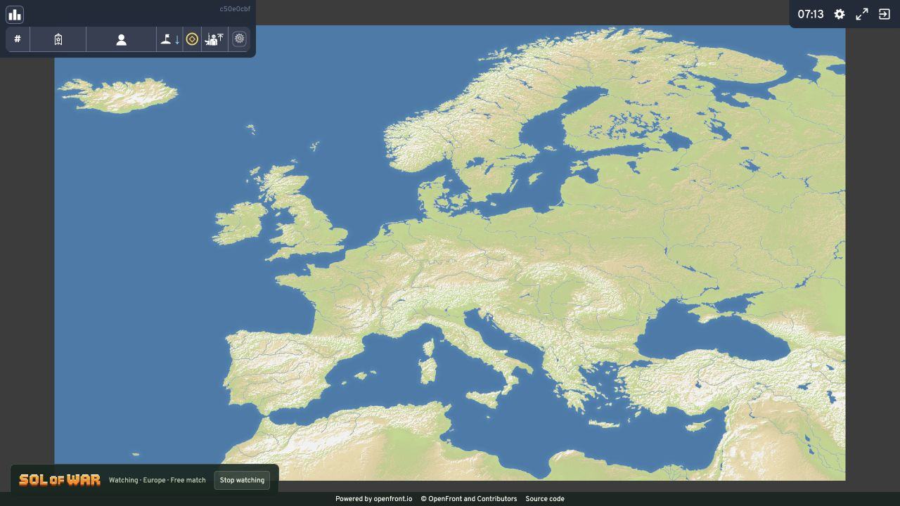

<p align="center">
  <a href="https://solofwar.fun"></a>
</p>

<h3 align="center">Conquer territory. Play free. Compete for SOL.</h3>

<p align="center">
  A browser strategy game built on OpenFront.<br>
  Choose your battlefield, build your territory, and outlast the opposition.
</p>

<p align="center">
  <a href="https://solofwar.fun"><strong>Play Sol of War</strong></a> ·
  <a href="PAYOUTS.md"><strong>Funds & payouts</strong></a> ·
  <a href="PAYMENTS.md#code-and-test-map"><strong>Inspect the payment code</strong></a> ·
  <a href="#run-it-yourself"><strong>Run locally</strong></a>
</p>

<p align="center">
  
  
  
</p>

## Pick your battlefield

| Free Play                             | Ranked                             | FFA Wagers                             |
| ------------------------------------- | ---------------------------------- | -------------------------------------- |
| FFA, 1v1, 2v2, Solo and tutorial      | Competitive 1v1 and 2v2            | Unranked free-for-all with SOL entries |
| Guest play without a wallet           | Ten placement matches per mode     | Funded entries form the prize pool     |
| Signed-in players keep their progress | Solo queue or bring a 2v2 teammate | 1% fee on completed prize pools        |

- **Bring your duo.** Queue together with no rank-gap restriction; premade matching uses the stronger player's Elo.
- **Accept, then play.** Timed acceptance, server-owned countdowns and funded-entry checks control match starts.
- **Build your record.** Stats, XP, prestige and per-mode ranks. Your account tools stay yours; visitors see stats and ranks.
- **Watch the battlefield.** Browse active games and spectate without taking a player slot.

<p align="center">
  
  <br><sub>Local Free Play spectator view.</sub>
</p>

## Completed mainnet paid match

A completed live 1v1 funded a **0.02 SOL mainnet pool** from two 0.01 SOL entries.
The finalized settlement paid **0.0198 SOL to the winner** and **0.0002 SOL to the treasury**.
[Inspect the complete route, all three receipts and the read-only verifier](MAINNET_MATCH_EVIDENCE.md).
These receipts verify mainnet transfers and settlement; match pools remain custodial.

## Follow the SOL

**Top up · Confirm entry · Play · Verify result · Receive payout · Withdraw**

The prize pool shown in the app is gross. Settlement uses the funded roster locked
at match start: 1% goes to the platform, and 99% to the winner or winning team.
Eligible cancellations return the full entry without the platform fee.

**Custody is explicit:** production was verified on October 31, 2026 at 00:30 UTC
running release `2bed045` with [user-owned wallets](USER_OWNED_WALLETS.md) enabled.
Fresh personal-wallet transfers require user approval; legacy wallets retain their
documented custody model until migrated. **Match pools remain operator-controlled**
in either mode. This is not trustless smart-contract escrow. Check the
[deployment evidence](SECURITY_EVIDENCE.md) and live metadata for later changes.

| Start here                                               | What you can inspect                                                             |
| -------------------------------------------------------- | -------------------------------------------------------------------------------- |
| [Mainnet match evidence](MAINNET_MATCH_EVIDENCE.md) | Completed paid 1v1: both entries, winner payout, treasury fee and reproducible checks |
| [Funds & payouts](PAYOUTS.md)                            | Deposits, fees, winnings, refunds, withdrawals and receipt checks                |
| [Payment architecture](PAYMENTS.md)                      | Source paths, signing boundaries, durable transfers and recovery                 |
| [Payment code & test map](PAYMENTS.md#code-and-test-map) | The implementation and regression tests for each safeguard                       |
| [Verification record](VERIFICATION.md)                   | Checks performed, test scope and remaining evidence limits                       |
| [Deployment and payment evidence](SECURITY_EVIDENCE.md)  | Running-release checks, mainnet payout evidence and real devnet receipts |
| [Account wallets](PLAYER_WALLETS.md)                     | Key storage, reservations and withdrawal authorization                           |

These are source documentation and developer-run checks, not an independent
security audit or a guarantee of the live service's configuration.

## Run it yourself

**Node 24.15.0 · npm 12.1.0 · TypeScript · Solana**

Local development uses **simulated payments**. No real SOL is required.

```sh
npm install --global --ignore-scripts npm@12.1.0
npm run inst
cp example.sow.env .env
npm run build:demo
npm run start:sow
```

Open **http://localhost:3000**. Guest Free Play, Solo and the tutorial work without
wallet credentials. Optional wallet sign-in needs a separate Privy development app
with the local origin allowed. Keep its server credentials in the ignored `.env`.

`npm run inst` installs the exact lockfile with dependency lifecycle scripts disabled.
Keep the configured dependency age/source restrictions. Local state lives in the
ignored `.frontpot-state/` directory; never use production ledgers or keys locally.

### Check the source

```sh
npm run verify:sow
```

Runs TypeScript, the focused application/payment regression suite, and the frontend
and corresponding-source build. Tests use fixtures. Broader upstream checks remain
available through `npm run typecheck` and `npm test`.

| Source                                                                            | Purpose                                                    |
| --------------------------------------------------------------------------------- | ---------------------------------------------------------- |
| [`src/frontpot/`](src/frontpot)                                                   | App, profiles, matchmaking, ledger and payments            |
| [`src/frontpot/payments/`](src/frontpot/payments)                                 | Funding, custody, settlement and withdrawal implementation |
| [`tests/frontpot/`](tests/frontpot)                                               | Application and payment regression tests                   |
| [`src/client/`](src/client), [`src/server/`](src/server), [`packages/`](packages) | Game client, server and engine                             |
| [`resources/`](resources)                                                         | Maps, translations and licensed assets                     |
| [`Dockerfile`](Dockerfile), [`Dockerfile.frontpot`](Dockerfile.frontpot)          | Sol of War container build                                 |

The Sol of War entry points are `demo.html`, `vite.demo.config.ts` and
`src/frontpot/Server.ts`. Internal `frontpot` and `solsiege` names remain for
compatibility. Other upstream launch scripts are not the application's launch path.

[Repository guide](REPOSITORY.md) · [Matchmaking](SHARED_MATCHMAKING.md) ·
[Operations](OPERATIONS.md) · [Devnet](DEVNET.md) · [Mainnet](MAINNET.md) ·
[Railway](RAILWAY.md)

## Built on an open foundation

Development began **October 3, 2026**, with daily work before the first Git import
on October 29. Maintained by [Sol of War](https://github.com/sol-of-war-dev).
The import date is not the project's start date; no earlier Git history exists.

Sol of War is an independent fork of [OpenFront](https://github.com/openfrontio/OpenFrontIO),
not endorsed by OpenFront. OpenFront is a fork/rewrite of
[WarFront.io](https://github.com/WarFrontIO).

**© OpenFront and Contributors.** Preserve the existing visible copyright notices.
[Source license & additional terms](LICENSE) · [Asset license](LICENSE-ASSETS) ·
[Licensing details](LICENSING.md) · [Credits](CREDITS.md).
Upstream proprietary artwork is excluded. The application retains its
[corresponding-source download](https://solofwar.fun/source).
